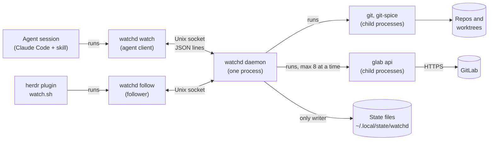
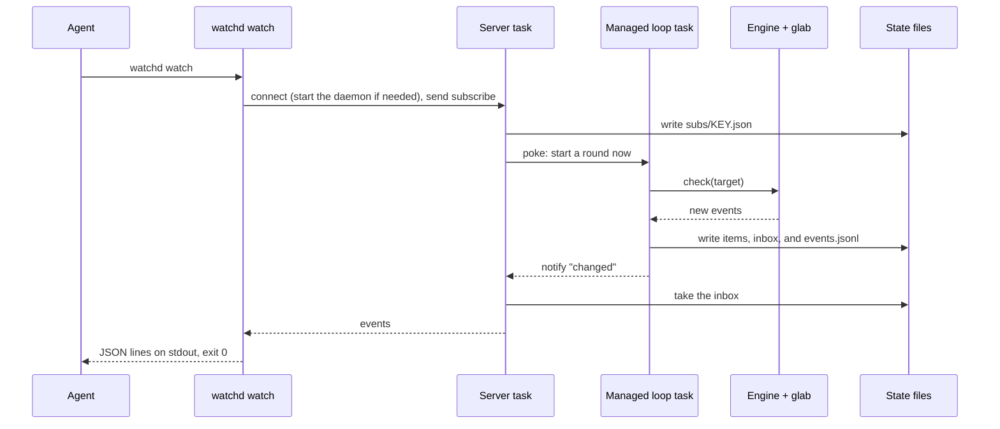
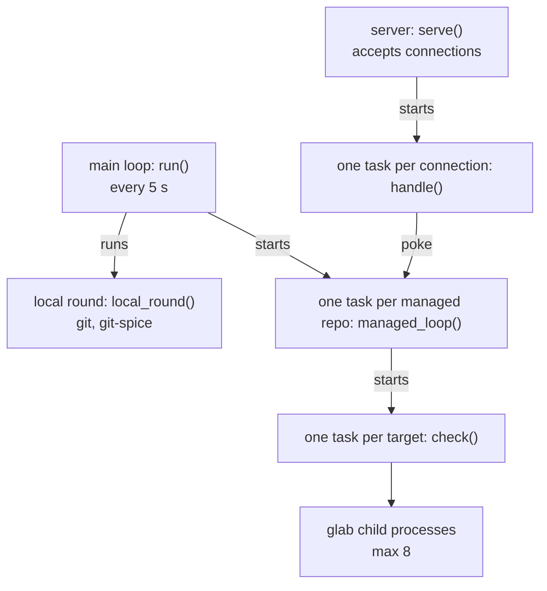

# watchd

`watchd` keeps the local git state and the GitLab state of each managed repo and worktree, with or
without an agent session. `watchd watch` waits, then prints the new GitLab events (comments, failed
pipelines, approvals) as JSON lines. The build, the tests, and the exit codes are in the
[main README](../README.md).

## Overview

One binary has three roles:

- Client: each `watchd watch`, `status`, `kind`, `route`, `report`, or `follow` call is a short
  process. It sends one JSON line to the daemon on `daemon.sock` and prints the answer
  (`src/protocol.rs`).
- Daemon: `watchd daemon` is one process for each user. It reads git and git-spice, polls GitLab,
  writes all state files, and answers the clients. If no daemon runs, the first client starts it.
- Engine: the daemon calls the engine through the `Engine` trait for each check. The engine runs
  `glab api` child processes. `watchd engine` runs one check, for debugging.

Two types of client stay connected:

- Agent: an agent session runs `watchd watch`. The client writes an agent record for the key of its
  folder and mode, and gets the events of that key. An agent record only selects events. The
  polling of a managed repo continues with no agent.
- Follower: `watchd follow` gets the sidebar state, then each new event log line and each sidebar
  change. The herdr plugin `watch.sh` is a follower.

Callers:

- The skills run `watchd watch`, `unsubscribe`, `status`, `route`, and `report`, as
  `references/watch/gitlab.md` tells them.
- `bump`, `hub`, `review-pr`, `debug-gitlab`, and `skills/work/work-start.sh` run `watchd kind`. It
  sets the kind of work of the worktree of the current folder.
- The herdr plugin `watch.sh` reads the stdout of `watchd follow`. It does not read the state files.

## Managed repos

The managed set (`repos.json`) has the repos that the daemon watches:

- A client request from a folder in a git repo adds the repo. A `follow` request adds no repo.
  `watchd watch --repo PATH` adds the repo of `PATH`.
- At start, the daemon adds the repo of each agent record.
- If the folder of a repo is gone, the main loop removes the repo.

The daemon makes no herdr calls.

## One watch

A `watch` client keeps its socket connection open until it has events.

If the daemon closes the socket, for example at a restart, the client connects again. If the send
of the events fails, the server puts the events back in the inbox.

## Inside the daemon

The daemon is one process with many tokio tasks. All tasks share one `Daemon` object
(`src/daemon/mod.rs`).

- Main loop: each tick (`WATCHD_TICK`, default 5 s), the loop ends the agent records with no Claude
  session, and the agent records with no client for 30 minutes. It removes the gone repos, starts a
  managed loop for each managed repo, and runs the local round. It restarts on a new binary. It
  stops after 10 minutes with no live agent and no follower.
- Local round: for each managed repo, one `git worktree list` and one read of the shared refs
  (`refs/spice/data` and `origin/HEAD`). The key of a worktree is its HEAD, its branch, and the
  shared refs. When the key changes, the round reads the git-spice stack
  (`git-spice log short --json`). Then it runs the conflict test: `git merge-tree` of the top
  branch and `origin/<default>`.
- Managed loop: one round is the fetch of origin, the fast-forward of the main checkout, the MR
  lookup of new branches, and one check for each target, in parallel. A blocked fast-forward is one
  open `pull-blocked` item. With no `origin/HEAD`, the fetch and the fast-forward are off. Then the
  loop waits: 120 seconds with a live hub agent of the repo, 900 seconds with none. A live agent
  with a shorter `--interval` makes the wait shorter. A poke ends the wait early. After a network
  error or a system sleep, the loop waits for the network.
- Targets: the hub (the project), each review link, the stack of each worktree and of each live
  stack agent, and the own open MRs with no worktree (key `<slug>-own`). An MR is in one stack or
  own target only.
- MR lookup: for a branch with no git-spice MR, the loop asks GitLab for the open MR of the branch
  one time. A result is a review link.
- Check: after a permanent error, or after 5 other errors in a row, the check ends the agent record
  of its key.
- Events: the events of a key with a live agent go to its inbox. The events of a key with no live
  agent go to the hub as open items. A live hub agent also gets the events that have an item.

Each task takes the `memory` lock before it changes the state in memory or the state files. After
each change, the task sends the `changed` signal, and the waiting connections read the files again.

## Source layout

| Path | Content |
| --- | --- |
| `src/main.rs` | The subcommands |
| `src/client/` | The client commands: flags, key, connection, start of the daemon, output, exit code |
| `src/protocol.rs` | The requests and responses on the socket |
| `src/server.rs` | The socket server, the waiting `subscribe`, the `follow` stream |
| `src/daemon/` | The main loop, the local round, the managed loops, the checks, the lock, the restart. `store.rs` writes the state files. |
| `src/local/` | The `git` and `git-spice` calls: worktree list, shared refs, stack, conflict test, fetch, fast-forward |
| `src/report.rs` | The Markdown text of `watchd report` |
| `src/core/` | Logic with no input or output: agent records, open items, event log lines, worktree state and targets |
| `src/engine/` | The GitLab checks. `hub.rs` watches the project. `stack.rs` watches the MRs of a stack or a review. `lookup.rs` finds the open MR of a branch. The module doc of `mod.rs` has the table of events. |
| `src/glab.rs`, `nap.rs`, `key.rs`, `paths.rs`, `persist.rs`, `platform.rs` | Helpers: `glab` calls, the wait between rounds, keys, paths, JSON files, macOS calls |
| `tests/` | The engine against a fake `glab`, and real test daemons with the fake engine (`src/engine/fake.rs`), real git repos, and a fake `git-spice` |

## State files

The base folder is `$XDG_STATE_HOME`, or `~/.local/state`. Each agent record and each target has a
key. A hub key is the repo slug (the short name of the repo). A stack key also has a hash of the
worktree. A review key also has `-review-IID` at the end.

| Path | Content |
| --- | --- |
| `watchd/daemon.sock`, `daemon.lock`, `daemon.pid` | The socket, the lock for one daemon, the PID |
| `watchd/watchd.log` | The text log |
| `watchd/events.jsonl` | The event log, which `follow` reads |
| `watchd/repos.json` | The managed set |
| `watchd/worktrees/HASH.json` | The state of one worktree: branch, key, stack, MRs, conflict, kind, stage. `HASH` is the first 12 characters of the SHA-1 of the path. |
| `watchd/reviews.json` | The review links: a worktree and the MR that it reviews |
| `watchd/subs/KEY.json` | One agent record |
| `watchd/inbox/KEY.jsonl` | Events that no client took yet |
| `watchd/items/KEY.json` | The open items of the key |
| `watch-gitlab/KEY.json` | The engine state: what GitLab showed at the last check |

## Single instance and restart

- One daemon: the daemon holds a `flock` on `daemon.lock`. The operating system frees the lock when
  the process ends, also after `kill -9`.
- Restart: `build.sh` renames a new file over the binary. The daemon sees the new file, stops its
  managed loops, and sends the started deliveries. Then it calls `exec` on the new binary. The lock
  and the socket stay open. The clients connect again.

## Migration

Clients that are older than an upgrade stay in use: agent sessions keep the old skill text, and a
waiting client keeps its old process. An upgrade converts the old state at the first start of the
new daemon. It keeps no second code path for the old format.

- CLI: keep the subcommand names and flags.
- Socket protocol: only add optional fields. The daemon reads the `subscribe` message of a version
  1 client.
- State files: `FORMAT_VERSION` in `src/persist.rs`. If you change the format, increase the version
  and convert the version before it at start.
