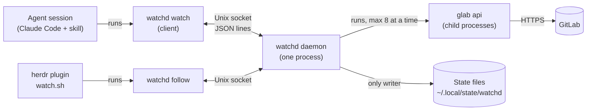
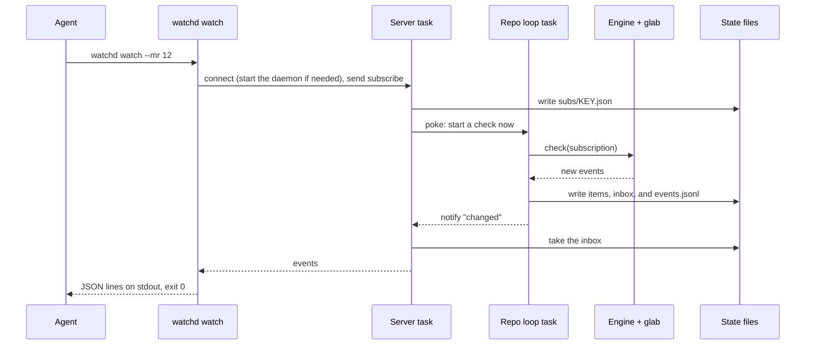
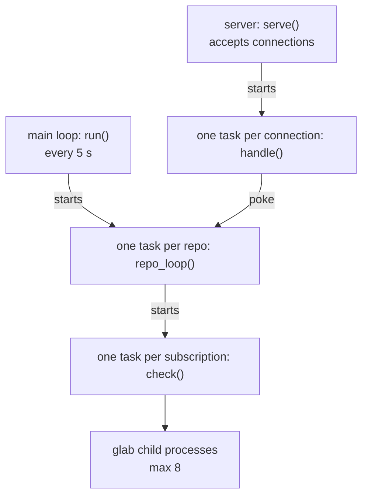

# watchd

`watchd` watches GitLab for agent sessions. `watchd watch` waits, then prints the new GitLab events
(comments, failed pipelines, approvals) as JSON lines. The build, the tests, and the exit codes are
in the [main README](../README.md).

## Overview

One binary has three roles:

- Client: each `watchd watch`, `status`, `kind`, `route`, `report`, or `follow` call is a short
  process. It sends one JSON line to the daemon on `daemon.sock` and prints the answer
  (`src/protocol.rs`).
- Daemon: `watchd daemon` is one process for each user. It polls GitLab, writes all state files,
  and answers the clients. If no daemon runs, the first client starts it.
- Engine: the daemon calls the engine through the `Engine` trait for each check. The engine runs
  `glab api` child processes. `watchd engine` runs one check, for debugging.

Callers:

- The skills run `watchd watch`, `unsubscribe`, `status`, `route`, and `report`, as
  `references/watch/gitlab.md` tells them.
- `bump`, `hub`, `review-pr`, `debug-gitlab`, and `skills/work/work-start.sh` run `watchd kind`.
- The herdr plugin `watch.sh` reads the stdout of `watchd follow`: the sidebar state, then each new
  event log line and each sidebar change. It does not read the state files.

## One watch

A `watch` client keeps its socket connection open until it has events.

If the daemon closes the socket, for example at a restart, the client connects again. If the send
of the events fails, the server puts the events back in the inbox.

## Inside the daemon

The daemon is one process with many tokio tasks. All tasks share one `Daemon` object
(`src/daemon/mod.rs`).

- Main loop: if the Claude session of a subscription is gone, or if the subscription had no client
  for 30 minutes, the loop ends the subscription. Restarts on a new binary. Stops after 10 minutes with no work.
- Connection: a `subscribe` waits until it has a delivery. A `follow` sends lines until the client
  goes away.
- Repo loop: one round is a check for each live subscription of the repo, in parallel. Then the
  loop waits for the shortest interval of the subscriptions (default 120 seconds). A poke ends the
  wait early. After a network error or a system sleep, the loop waits for the network.
- Check: after a permanent error, or after 5 other errors in a row, the check ends the
  subscription.

Each task takes the `memory` lock before it changes the state in memory or the state files. After
each change, the task sends the `changed` signal, and the waiting connections read the files again.

## Source layout

| Path | Content |
| --- | --- |
| `src/main.rs` | The subcommands |
| `src/client/` | The client commands: flags, key, connection, start of the daemon, output, exit code |
| `src/protocol.rs` | The requests and responses on the socket |
| `src/server.rs` | The socket server, the waiting `subscribe`, the `follow` stream |
| `src/daemon/` | The main loop, the repo loops, the checks, the lock, the restart. `store.rs` writes the state files. |
| `src/report.rs` | The Markdown text of `watchd report` |
| `src/core/` | Logic with no input or output: subscriptions, open items, event log lines, herdr workspaces |
| `src/engine/` | The GitLab checks. `hub.rs` watches the project. `stack.rs` watches the MRs of a stack or a review. The module doc of `mod.rs` has the table of events. |
| `src/glab.rs`, `nap.rs`, `key.rs`, `paths.rs`, `persist.rs`, `platform.rs` | Helpers: `glab` calls, the wait between rounds, keys, paths, JSON files, macOS calls |
| `tests/` | The engine against a fake `glab`, and real test daemons with the fake engine (`src/engine/fake.rs`) |

## State files

The base folder is `$XDG_STATE_HOME`, or `~/.local/state`. Each subscription has a key. A hub key
is the repo slug (the short name of the repo). A stack key also has a hash of the worktree. A review
key also has `-review-IID` at the end.

| Path | Content |
| --- | --- |
| `watchd/daemon.sock`, `daemon.lock`, `daemon.pid` | The socket, the lock for one daemon, the PID |
| `watchd/watchd.log` | The text log |
| `watchd/events.jsonl` | The event log, which `follow` reads |
| `watchd/subs/KEY.json` | One subscription |
| `watchd/inbox/KEY.jsonl` | Events that no client took yet |
| `watchd/items/KEY.json` | The open items of the key |
| `watchd/workspaces/ID.json` | The record of one herdr workspace |
| `watch-gitlab/KEY.json` | The engine state: what GitLab showed at the last check |

## Single instance and restart

- One daemon: the daemon holds a `flock` on `daemon.lock`. The operating system frees the lock when
  the process ends, also after `kill -9`.
- Restart: `build.sh` renames a new file over the binary. The daemon sees the new file, stops its
  repo loops, and sends the started deliveries. Then it calls `exec` on the new binary. The lock
  and the socket stay open. The clients connect again.

## Compatibility

Clients that are older than an upgrade stay in use: agent sessions keep the old skill text, and a
waiting client keeps its old process. Keep these interfaces stable:

- CLI: the subcommand names and flags. If you rename one, accept the old name for one release.
- Socket protocol: the messages between the client and the daemon. Only add optional fields.
- State files: `FORMAT_VERSION` in `src/persist.rs`. If you change the format, increase the
  version and convert the version before it.
