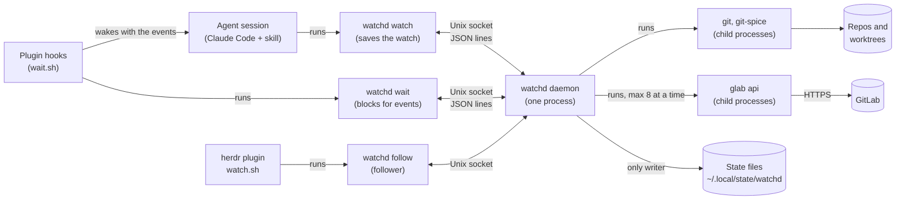
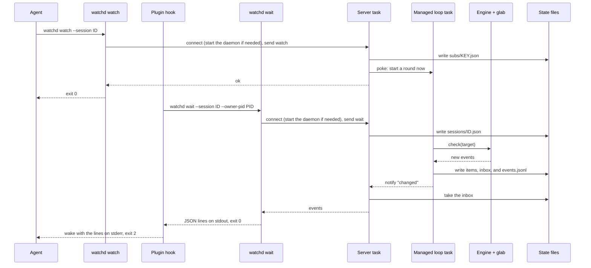
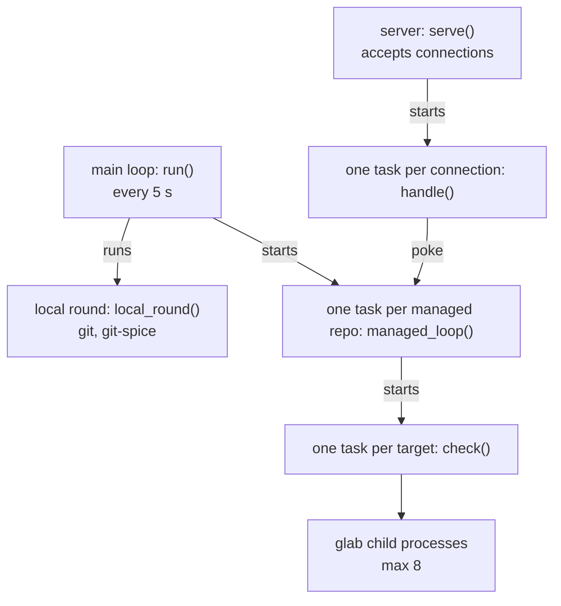

# watchd

`watchd` keeps the local git state and the GitLab state of each managed repo and worktree, with or
without an agent session. `watchd watch` saves the watch of an agent session. `watchd wait` waits,
then prints the new GitLab events (comments, failed pipelines, approvals) as JSON lines. The build,
the tests, and the exit codes are in the [main README](../README.md).

## Overview

One binary has three roles:

- Client: each `watchd watch`, `wait`, `status`, `kind`, `route`, `report`, or `follow` call is a
  process that sends one JSON line to the daemon on `daemon.sock` and prints the answer
  (`src/protocol.rs`).
- Daemon: `watchd daemon` is one process for each user. It reads git and git-spice, polls GitLab,
  writes all state files, and answers the clients. If no daemon runs, the first client starts it.
  A repo with `watchd.stateHome` has its own daemon (see "Managed repos").
- Engine: the daemon calls the engine through the `Engine` trait for each check. The engine runs
  `glab api` child processes. `watchd engine` runs one check, for debugging.

Two types of client stay connected:

- Waiter: `watchd wait` gets the events of all watches of one session. A `watchd watch` call is
  short: it writes an agent record for the key of its folder and mode, with the session ID, and
  exits. An agent record only selects events. The polling of a managed repo continues with no
  agent.
- Follower: `watchd follow` gets the sidebar state, then each new event log line and each sidebar
  change. The herdr plugin `watch.sh` is a follower.

Callers:

- The skills run `watchd watch`, `unsubscribe`, `status`, `route`, and `report`, as
  `references/watch/gitlab.md` tells them.
- The Claude Code plugin (`integrations/claude-code/`) runs `watchd wait` in its hooks (see
  "Claude Code plugin").
- `bump`, `hub`, `review-pr`, `debug-gitlab`, and `skills/work/work-start.sh` run `watchd kind`. It
  sets the kind of work of the worktree of the current folder.
- The herdr plugin `watch.sh` reads the stdout of `watchd follow`. It does not read the state files.

## Managed repos

The managed set (`repos.json`) has the repos that the daemon watches:

- A client request from a folder in a git repo adds the repo. A `follow` or `wait` request adds no
  repo.
  `watchd watch --repo PATH` adds the repo of `PATH`.
- At start, the daemon adds the repo of each agent record.
- If the folder of a repo is gone, the main loop removes the repo.

A repo with the git configuration key `watchd.stateHome` has its own daemon. Its clients use the
value as the base folder of the state files, and they start no daemon. The
[sample](sample/README.md) uses it for its test daemon.

The daemon makes no herdr calls.

## One watch

A `watch` call saves the watch and exits at once. A `wait` call keeps its socket connection open
until a watch of the session has events.

- An idle session has a connected waiter. A delivery ends the waiter. During the turn that the
  delivery starts, no waiter is connected, and the events wait in the inbox. The `Stop` hook at the
  end of that turn starts the next waiter. A new waiter replaces the old one of the session.
- `watchd wait` checks the owner PID each 3 seconds, only that PID. In three cases it exits 0 with
  no output: the owner ends, the session has no watch, or a newer waiter replaces it.
- If the daemon closes the socket, for example at a restart, `watchd wait` connects again. If the
  send of the events fails, the server puts the events back in the inbox.
- Replace: a `watch` of a second session for a key with a record takes the record. The next `wait`
  of the first session gets one `replaced` event for the key.
- Rename: a `wait` with `--rename-owner-session` and a new session ID takes the watches of the live
  session with the same owner PID. An away session keeps its watches. The Claude Code plugin sets
  the flag only after `/clear`.

## Inside the daemon

The daemon is one process with many tokio tasks. All tasks share one `Daemon` object
(`src/daemon/mod.rs`).

- Main loop: each tick (`WATCHD_TICK`, default 5 s), the loop checks the owner process of each
  session. It ends the agent records of a session that is away for the grace period, and the
  agent records with a gone worktree folder. It removes the gone repos, starts a managed loop for
  each managed repo, and runs the local round. It restarts on a new binary. It stops after 10
  minutes with no agent record and no follower. The session rules:
  - Live: the owner process is alive.
  - Away: the owner process is gone. The loop sets `owner_gone_at`. The agent records and the
    inbox stay, so the events wait for the return of the session.
  - Back: a `wait` of the same session ID, with a new owner PID, clears `owner_gone_at`.
  - Ended: the session is away for the grace period (`WATCHD_GRACE_SECONDS`, default 1800 s). The
    loop ends each agent record of the session, and the open items go to the hub. Then it removes
    the session record.
  - Worktree gone: the loop ends the record with the error `watchd: the worktree is gone: PATH`.
    The next `wait` of the session gets the error.
  - No client limit: during a turn that a delivery started, no waiter is connected, and that is
    normal.
- Local round: for each managed repo, one `git worktree list` and one read of the shared refs
  (`refs/spice/data` and `origin/HEAD`). The key of a worktree is its HEAD, its branch, and the
  shared refs. When the key changes, the round reads the git-spice stack
  (`git-spice log short --json`). Then it runs the conflict test: `git merge-tree` of the top
  branch and `origin/<default>`. The test does not use the branches of merged or closed MRs. If a
  branch below the top has an ended MR, only the commits above that branch count. When an MR ends,
  the next local round runs the test again.
- Managed loop: one round is the fetch of origin, the fast-forward of the main checkout, the MR
  lookup of new branches, and one check for each target, in parallel. A blocked fast-forward is one
  open `pull-blocked` item. With no `origin/HEAD`, the fetch and the fast-forward are off. Then the
  loop waits: 120 seconds with a live hub agent of the repo, 900 seconds with none. A live agent
  with a shorter `--interval` makes the wait shorter. A poke ends the wait early. After a network
  error or a system sleep, the loop waits for the network.
- Targets: the hub (the project), each review link, the MRs of each worktree and of each live
  author agent, and the own open MRs with no worktree (key `<slug>-own`). An MR is in one author
  or own target only.
- MR lookup: for a branch with no git-spice MR, the loop asks GitLab for the open MR of the branch
  one time. A result is a review link.
- Check: after a permanent error, or after 5 other errors in a row, the check ends the agent record
  of its key.
- Events: the events of a key with an agent record go to its inbox, also while its session is
  away. The events of a key with no agent record go to the hub as open items.
- Router: for the events that go to a live hub, `src/engine/router/` selects an action for each
  event, and starts the review and bump agents. The lock is free during the agent starts. A failed
  default-branch job with a runner failure gets 2 retries at most, in a task of its own. A handled
  event does not go to the hub inbox. If a round has only handled events, the daemon writes the
  hub report to the board file, and `watchd board` shows it. Else all events go to the inbox, and
  the client gets only the events that the router did not handle. The next hub report also shows
  the handled rows.

Each task takes the `memory` lock before it changes the state in memory or the state files. After
each change, the task sends the `changed` signal, and the waiting connections read the files again.

## Source layout

| Path | Content |
| --- | --- |
| `src/main.rs` | The subcommands |
| `src/client/` | The client commands: flags, key, connection, start of the daemon, output, exit code |
| `src/protocol.rs` | The requests and responses on the socket |
| `src/server.rs` | The socket server, the waiting `wait`, the `follow` stream |
| `src/daemon/` | The main loop, the local round, the managed loops, the checks, the lock, the restart. `store.rs` writes the state files. |
| `src/local/` | The `git` and `git-spice` calls: worktree list, shared refs, stack, conflict test, fetch, fast-forward |
| `src/report.rs` | The Markdown text of `watchd report` |
| `src/board.rs` | The text of `watchd board`: one block for each row, with the URL of the comment, the MR, or the pipeline |
| `src/core/` | Logic with no input or output: agent records, open items, event log lines, worktree state and targets |
| `src/engine/` | The GitLab checks. `hub.rs` watches the project. `mrs.rs` watches the MRs of a worktree or a review. `lookup.rs` finds the open MR of a branch. The module doc of `mod.rs` has the table of events. `router/` selects the action of each hub event. |
| `src/workspaces.rs` | The herdr calls: the board pane and the agent starts |
| `src/glab.rs`, `nap.rs`, `key.rs`, `paths.rs`, `persist.rs`, `platform.rs` | Helpers: `glab` calls, the wait between rounds, keys, paths, JSON files, macOS calls |
| `integrations/claude-code/` | The Claude Code plugin: hooks, `wait.sh`, and the runner file |
| `tests/` | The engine against a fake `glab`, and real test daemons with the fake engine (`src/engine/fake.rs`), real git repos, and a fake `git-spice` |

## State files

The base folder is `$XDG_STATE_HOME`, or `~/.local/state`. A client in a repo with
`watchd.stateHome` uses the value of that key. Each agent record and each target has a
key. A hub key is the repo slug (the short name of the repo). An author key also has a hash of
the worktree. A review key also has `-review-IID` at the end.

| Path | Content |
| --- | --- |
| `watchd/daemon.sock`, `daemon.lock`, `daemon.pid` | The socket, the lock for one daemon, the PID |
| `watchd/watchd.log` | The text log |
| `watchd/events.jsonl` | The event log, which `follow` reads |
| `watchd/repos.json` | The managed set |
| `watchd/worktrees/HASH.json` | The state of one worktree: branch, key, stack, MRs, conflict, kind, stage. `HASH` is the first 12 characters of the SHA-1 of the path. |
| `watchd/reviews.json` | The review links: a worktree and the MR that it reviews |
| `watchd/subs/KEY.json` | One agent record, with the ID of its session |
| `watchd/sessions/ID.json` | One session: the owner PID and `owner_gone_at`. `replaced` has the keys that a different session took. `ended` has the keys whose record ended while the session had them. |
| `watchd/inbox/KEY.jsonl` | Events that no waiter took yet |
| `watchd/inbox/KEY.routing` | The report fields of the handled rows in the inbox, for the next hub report |
| `watchd/items/KEY.json` | The open items of the key |
| `watchd/items/KEY.board` | The newest hub report as JSON. `watchd board` draws it at the width of its pane. |
| `watchd/items/KEY.retries` | The retry count of each failed job of the hub, as `<pipeline id>:<job name>` |
| `watch-gitlab/KEY.json` | The engine state: what GitLab showed at the last check |

## Single instance and restart

- One daemon: the daemon holds a `flock` on `daemon.lock`. The operating system frees the lock when
  the process ends, also after `kill -9`.
- Restart: `build.sh` renames a new file over the binary. The daemon sees the new file, stops its
  managed loops, and sends the started deliveries. Then it calls `exec` on the new binary. The lock
  and the socket stay open. The clients connect again.

## Claude Code plugin

The folder `integrations/claude-code/` is a Claude Code plugin. It has all Claude Code knowledge.
`watchd` has none.

| File | Content |
| --- | --- |
| `.claude-plugin/plugin.json` | The name `watchd` and the `version` |
| `hooks/hooks.json` | The `SessionStart` and `Stop` hooks. Both run `wait.sh` with `asyncRewake` and a timeout of one week. |
| `wait.sh` | Runs `watchd wait` with `CLAUDE_CODE_SESSION_ID` and `CLAUDE_PID`. Exit 2 wakes Claude with the events or `watchd error: <text>` on stderr. |
| `wait.test.sh` | The test of `wait.sh`, with a fake `watchd` on `PATH` |
| `watch-runner.md` | The runner file: how the agent starts the watch and reads the results |

Claude Code reads this local plugin from its folder, through the symlink
`~/.claude/local-marketplace/watchd` of the marketplace `local-pins`. A change of a plugin file
takes effect at the next session start or after `/reload-plugins`.

## Migration

Clients that are older than an upgrade stay in use: agent sessions keep the old skill text, and a
waiting client keeps its old process. An upgrade converts the old state at the first start of the
new daemon. It keeps no second code path for the old format.

- CLI and socket protocol: a change of the client API keeps no old path. The daemon answers an old
  client with an error, for example a `subscribe` request. The user starts the watch again one
  time.
- State files: `FORMAT_VERSION` in `src/persist.rs`. If you change the format, increase the version
  and convert the version before it at start. At the first start with a new version, the daemon
  ends each old agent record, so its open items go to the hub. It removes the old owner files
  (`inbox/KEY.owner`).
